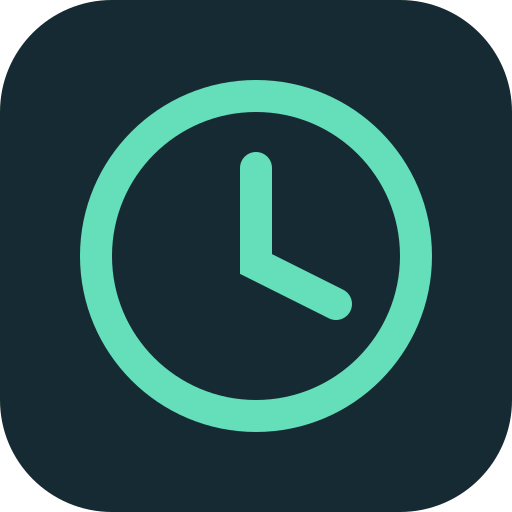
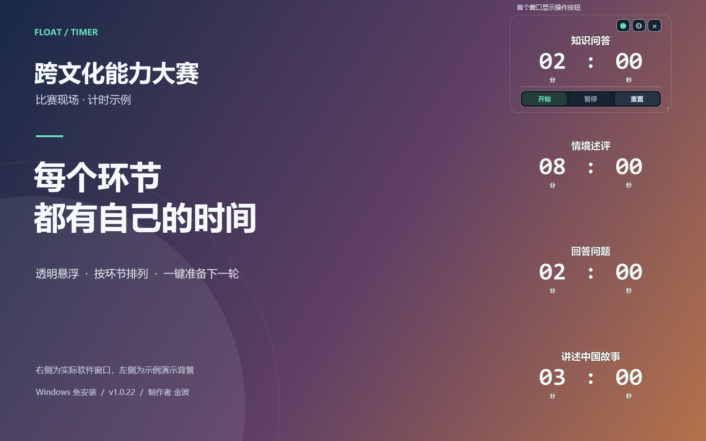
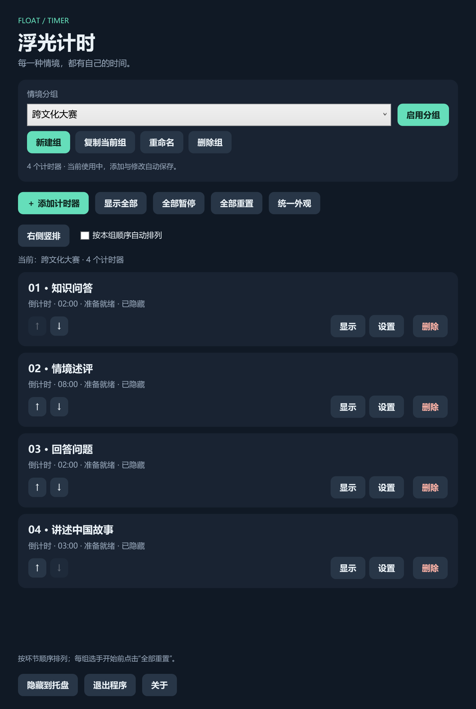
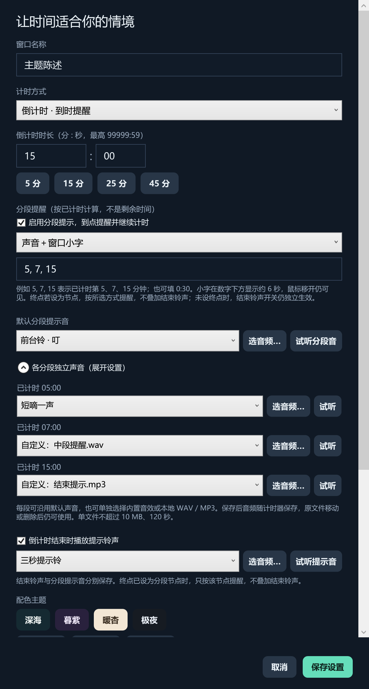

<p align="center">
  
</p>

# 浮光计时 FloatTimer

适用于比赛、课堂和演讲的 Windows 多窗口悬浮计时器。支持倒计时、正计时、情境分组，以及各分段使用不同的内置或自定义提示音。

**当前版本：1.0.22**

## 下载与运行

- **[⬇ 下载 Windows 免安装版 v1.0.22](https://github.com/memetics1980/FloatTimer/releases/download/v1.0.22/FloatTimer-1.0.22.zip)**
- [查看 v1.0.22 发布页面](https://github.com/memetics1980/FloatTimer/releases/tag/v1.0.22)
- [下载一页打印指南（Word）](https://github.com/memetics1980/FloatTimer/releases/download/v1.0.22/FloatTimer-Quick-Guide-1.0.22.docx)

解压后双击 `FloatTimer.exe`，无需安装、管理员权限或联网。适用于 Windows 10 / 11，使用系统自带的 .NET Framework 4.x。

请解压到可写入的文件夹，程序会在旁边保存 `FloatTimer.settings.json`。升级时先退出旧版，再替换程序，保留原设置文件。

## 软件截图

以下截图使用 1.0.22 的实际界面与独立示例配置。

### 悬浮计时窗口

多个透明计时窗口可叠放在演示背景上，按比赛环节排列。鼠标移入时显示开始、暂停、重置和设置按钮，移开后保留名称与时间。



图中左侧为示例演示背景，右侧为实际软件窗口；第一个窗口展示鼠标移入时的操作按钮。

### 分组管理

新建、复制或切换场景分组，使用 ↑ / ↓ 调整环节顺序，再一键右侧竖排。每组选手开始前，点击“全部重置”即可恢复初始状态。



### 分段提示音设置

同一计时器可以在不同时间点使用不同声音。下图演示已计时第 5 分钟使用内置短嘀、第 7 分钟使用自定义 WAV、第 15 分钟使用自定义 MP3；每段均可试听并保存，也可选择“沿用默认分段音”。



## 主要功能

| 功能 | 说明 |
| --- | --- |
| 多个悬浮窗口 | 每个窗口独立命名、倒计时或正计时，可拖动、缩放并置顶 |
| 透明外观 | 默认透明，可单独调整配色与透明度，也可统一当前组外观 |
| 情境分组 | 先新建组，再添加计时器；支持复制、重命名、切换和删除成员 |
| 窗口排列 | 按组内顺序在屏幕右侧竖排，一列放不下时自动向左分列 |
| 全部重置 | 当前组所有计时器恢复初始时间并保持停止，便于下一组选手使用 |
| 到时提醒 | 倒计时停在 00:00，窗口边缘持续闪烁，直到重置 |
| 分段提醒 | 按已计时多久设置多个节点，中途提醒继续计时；每段可以使用不同声音 |
| 自定义音频 | 设置内直接选择本地 WAV / MP3，支持试听并随设置保存 |
| 小字提示 | 可选声音、小字或两者同时，小字在数字下方显示约 6 秒 |
| 托盘与触控 | 关闭管理面板隐藏到托盘；管理列表和设置页支持触屏上下滑动 |

## 比赛现场快速操作

1. 点击“新建组”，输入比赛或场景名称。
2. 在该组添加各环节计时器，填写名称、计时方式和时长。
3. 用 ↑ / ↓ 调整顺序，再点击“右侧竖排”。
4. 每组选手开始前点击“全部重置”，到对应环节时点击该窗口的“开始”。
5. 暂时中断点击“暂停”，恢复时点击“继续”。“重置”只恢复初始状态，不会自动开始。

鼠标移入计时窗口后显示控制按钮，移开后自动隐藏。窗口右上角 × 只隐藏窗口；真正删除计时器请使用管理面板内的“删除”。

## 为不同分段设置不同提示音

例如总时长 15 分钟，在计时器设置中启用分段提示，填写 `5, 7, 15`，表示**已计时第 5、7、15 分钟**，也支持 `0:30` 这样的秒级节点。

展开“各分段独立声音”，可分别为每段选择内置声音，或点击“选音频…”导入 WAV / MP3。点击该段的“试听”检查，最后点击“保存设置”。选择“沿用默认分段音”的节点会跟随上方默认声音。

结束铃声也可单独选择或导入。若终点同时是分段节点，只按该节点提醒，不叠加结束铃声。

自定义音频随 `FloatTimer.settings.json` 保存，移动或删除原音频文件后仍可使用。迁移电脑时复制程序和设置文件即可。单文件限 10 MB、120 秒。

## 使用说明

- [完整使用说明](docs/使用说明.txt)
- [快速使用指南](docs/快速使用指南.txt)
- [比赛工作人员一页 Word 指南](docs/浮光计时_比赛工作人员快速使用指南.docx)
- [源码构建说明](docs/构建说明.md)

## 从源码构建

在 Windows PowerShell 中，从仓库根目录运行：

```powershell
powershell.exe -NoProfile -ExecutionPolicy Bypass -File .\src\FloatTimer\build.ps1 -OutputDirectory .\dist\FloatTimer
```

构建使用系统 .NET Framework C# 编译器，无需 .NET SDK、NuGet 或网络。生成的 `FloatTimer.exe` 已内嵌前台铃音频，可独立运行。

本仓库只提供当前源码与文档，Release 仅发布 **v1.0.22**。
